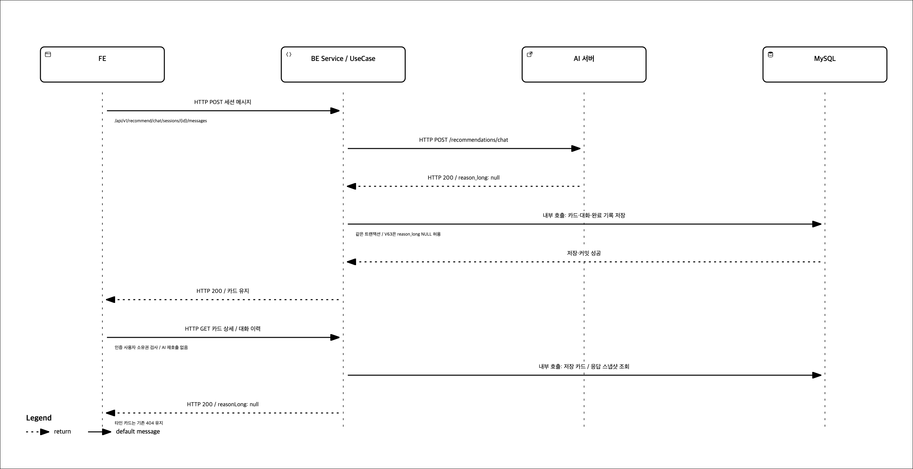

# 긴 추천 이유가 없는 카드의 저장과 복원

- [편집 가능한 Archify 원본](sequence.json). `Archify 2.17`의 sequence 형식이다.
- POST `/api/v1/recommend/chat/sessions/{sessionId}/messages` → AI POST `/recommendations/chat` → 카드·발화·완료 기록을 같은 트랜잭션에 저장한다.
- GET `/api/v1/recommend/cards/{recommendationCardId}`와 세션 메시지 조회는 저장된 카드/스냅샷을 읽으며 AI를 다시 호출하지 않는다. 타인 카드의 기존404도 유지한다.
- 그림의 HTTP 화살표와 내부 저장/조회 호출을 구분했다. 기존 추천 HTTP와 스냅샷 스키마는 변경하지 않는다.
- 근거: `ChatSessionService.send`, `CompleteChatRequestUseCase`, `SaveRecommendationCardsUseCase`, `GetRecommendationCardUseCase`.

## 검증

- `validate`/`deliver --quality showcase`: 9개 artifact 검사 통과, composition 오류0·경고0.
- `visual-check`: 1440×900, 1600×1000, 1920×1080, 2048×1320에서 overflow 없음. 양 끝 크기의 light/dark 캡처 확인.
- 렌더링한 light/dark 화면과 별도 흑백 PNG에서 글자 잘림·겹침·화살표 방향을 직접 확인했다. 위 자동 검사는 애플리케이션 동작 검증이 아니다.
- PNG는 전달된 SVG의 구조를 유지하고 흰 배경·검은 선/텍스트로 export했다. HTML 전체·로컬 문서는 이 PR에 포함하지 않는다.
- 원본 문구는 한국어다. Archify 고정 Viewer UI와 HTML lang은 지원 기본값인 English다.

전달 원본 SHA-256: `ddc43cf1c0daea61ec35929fd68b7a1ec74126c03615517e74b60da9fdecb11f` (2266 bytes).
로컬 HTML SHA-256: `8c547026d9157fa4dadf7d033a9c48df8ddb3921d6d9658fa1aedcf506bcb882` (802554 bytes).
게시 PNG SHA-256: `019640135ae6f96ef9cd95acbf21ad036b3c7172b4b9ab24620d8815fed1de72`.
