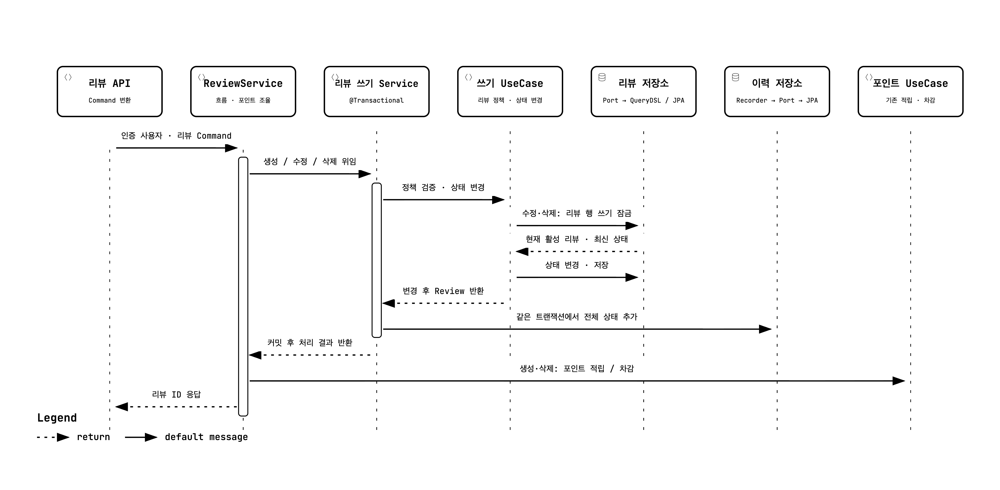

# 리뷰 변경과 이력 저장

Issue #292의 구현 흐름을 나타내는 Archify 시퀀스 다이어그램입니다. 리뷰 이력에는 IP를 수집하거나 저장하지 않습니다.

- `review-history.sequence.json`: 다이어그램 원본 명세
- `review-history.html`: Archify에서 검증하고 전달한 인터랙티브 HTML
- `review-history.monochrome.png`: PR 본문용 흰 배경·검은 선 이미지
- `delivery.json`, `validation.json`: 명세/HTML SHA-256과 showcase 9/9 검증 기록
- `review-history.visual-check.json`, `review-history.visual-check.html`: 4개 데스크톱 크기, 밝은/어두운 테마 브라우저 검증과 화면 자료
- `review-receipt.json`: 이미지 시각 검토와 파생 이미지의 SHA-256

## 읽는 방법

수정·삭제는 기존 리뷰 행의 쓰기 잠금을 얻은 뒤 상태를 변경합니다. 신규 작성은 새 리뷰를 저장하므로 기존 행 잠금 단계가 없습니다. 실제 변경이 없는 수정은 저장과 이력 추가를 생략합니다.

`ReviewService`는 CUD 흐름을 `ReviewWriteService`에 위임합니다. 이 서비스의 `@Transactional` 메서드가 정책 검증, 쓰기 UseCase와 Recorder를 조율합니다. 리뷰 변경과 이력 추가는 같은 트랜잭션에서 함께 커밋되거나 롤백됩니다. 이 경계를 별도 Spring 서비스 빈에 선언해 트랜잭션 경계를 코드 구조에서 확인할 수 있게 했습니다.

쓰기 트랜잭션이 끝나면 바깥 `ReviewService`가 포인트를 적립하거나 차감합니다. 따라서 포인트 실패가 이미 커밋한 리뷰와 이력을 되돌리지 않습니다. 외부 트랜잭션이 먼저 열려 있으면 기본 REQUIRED 전파 정책에 따라 쓰기 서비스가 그 트랜잭션에 참여합니다.

Recorder는 같은 리뷰의 직전 기록 시각을 확인합니다. 서버 시계가 뒤로 갔으면 직전 시각을 유지하고, 같은 시각의 이력은 ID로 순서를 구분합니다.

## 스타일과 검증

원본 HTML의 테마와 구조는 Archify 출력 그대로 보존했습니다. 흑백 PNG는 브라우저 메모리에서 SVG의 색상만 변경한 뒤 Archify의 기본 PNG 내보내기로 생성했습니다. 노드, 선, 문구의 기하 구조는 동일합니다. `export-monochrome.cjs`는 기존 Playwright 설치와 Chrome이 있는 환경에서 `node export-monochrome.cjs <이 디렉터리>`로 실행합니다. 저장소에 새 의존성을 추가하지 않습니다.

검증은 구조 검사, 실제 브라우저 측정, 이미지 시각 검토를 구분합니다. 브라우저 검증은 1440×900, 1600×1000, 1920×1080, 2048×1320을 포함합니다. 한국어 본문을 사용하지만 Archify의 고정 Viewer UI와 HTML lang은 영어로 제공됩니다.

## 제외 범위

신고/분쟁 처리, 이력 조회 API·화면, 기존 리뷰 초기 이력 복사, 회원 탈퇴 연동, 3년 만료 삭제는 이번 구현 범위에 포함하지 않습니다.
